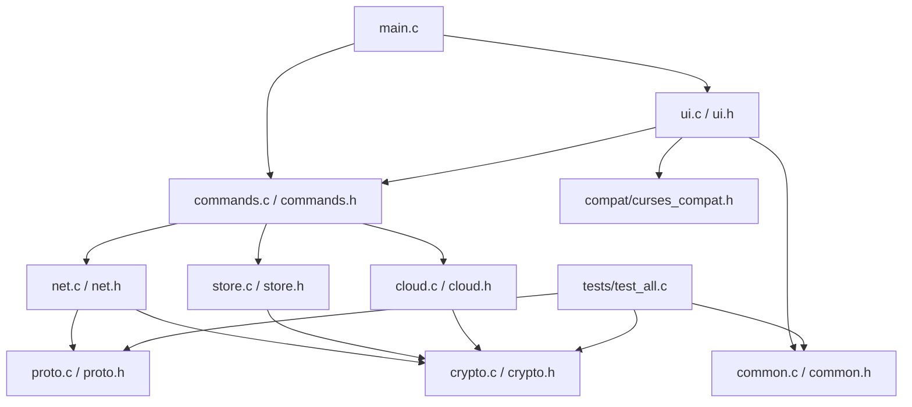

# Architecture Map

## Module roles
- [[main.c]] — program entry and high-level startup.
- [[ui.c]] and [[ui.h]] — terminal interface and input handling.
- [[commands.c]] and [[commands.h]] — command parsing and dispatch.
- [[net.c]] and [[net.h]] — networking layer.
- [[proto.c]] and [[proto.h]] — protocol framing/serialization helpers.
- [[crypto.c]] and [[crypto.h]] — cryptographic helpers.
- [[store.c]] and [[store.h]] — local persistence.
- [[cloud.c]] and [[cloud.h]] — cloud-provider integration.
- [[common.c]] and [[common.h]] — shared types/utilities.
- [[server.c]] — server/listener-side functionality.
- [[curses_compat.h]] — curses portability shims.

See individual file notes for source-specific relationships. The diagram is a conceptual map based on file roles, not a verified call graph.
